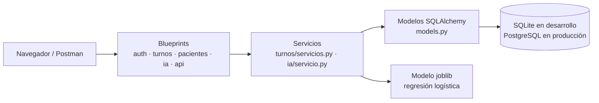
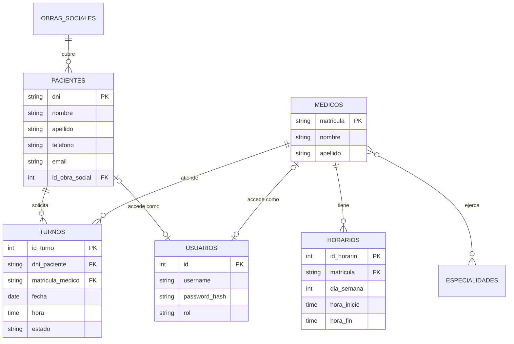

# Sistema de Gestión de Turnos para Consultorio Médico

**Prototipo funcional en Flask con integración de IA.** Segunda entrega de *Análisis y Metodología de Sistemas*: una versión mínima y recortada del sistema definido en el SRS de la primera entrega (*Sistema de Gestión de Turnos para Consultorio Médico*, versión 1.0).

- **Aplicación en producción (Render + PostgreSQL):** https://turnos-consultorio-6n39.onrender.com
- **Repositorio:** https://github.com/HectorAG05/turnos-consultorio-flask
- **Autor:** Hector Alexander George Rodriguez (modalidad individual)

> Render apaga el servicio gratuito cuando no se usa, así que la primera visita puede tardar alrededor de un minuto en cargar.

---

## Cómo probarlo

Entrá al link de producción e iniciá sesión con alguno de estos usuarios de demostración:

| Usuario | Rol | Qué puede hacer |
|---|---|---|
| `laura` | Secretaria | Ver la agenda de todos los médicos, dar de alta, reprogramar y cancelar turnos, registrar asistencia, administrar pacientes y usar la predicción de IA |
| `sgomez` | Médica (Dra. Silvia Gómez) | Ver solo su agenda y registrar si el paciente asistió o faltó |
| `mperez` | Médico (Dr. Martín Pérez) | Lo mismo, con su propia agenda |
| `lucia` | Paciente (Lucía Fernández) | Ver solo sus turnos, pedir uno nuevo, reprogramarlo (con 24 h de anticipación) o cancelarlo |

La contraseña de los usuarios de demostración va en el mensaje de entrega. No se publica acá porque el repositorio es público y, como pide la consigna, los datos sensibles no se suben al código. En producción se define con la variable de entorno `SEED_PASSWORD`.

También se puede crear una cuenta de paciente nueva desde **«Registrate»** en la pantalla de login.

**Recorrido sugerido (como `laura`):**

1. **Agenda:** se ven los turnos del día con la columna **«Riesgo de ausencia»** que calcula el modelo de IA.
2. **Nuevo turno:** buscar al paciente por DNI, elegir especialidad, médico y fecha, y tomar uno de los horarios libres.
3. Abrir el turno y **reprogramarlo** o **cancelarlo**. El turno cancelado no se borra: queda en el historial con estado «cancelado».
4. **Pacientes:** alta, modificación, ficha con su historial y eliminación (solo si no tiene turnos).
5. **Predicción IA:** cargar los datos de un turno y ver al instante la probabilidad de ausentismo.

---

## Cumplimiento de los requisitos de la entrega

| Requisito | Cómo se cumple |
|---|---|
| Aplicación en **Flask** | Flask 3.1 (`run.py`, `app/`) |
| **Entorno virtual `.venv`** | Las dependencias se instalan en `.venv` (ignorado en Git) desde `requirements.txt` |
| **CRUD completo** sobre base de datos con **SQLAlchemy** | Turnos y pacientes, con Flask-SQLAlchemy. SQLite en desarrollo y PostgreSQL en producción |
| Create — **POST** | `POST /api/turnos`, `POST /api/pacientes` y los formularios de alta |
| Read — **GET** | `GET /api/turnos`, `GET /api/turnos/<id>`, `GET /api/pacientes`, la agenda y la ficha |
| Update — **PUT / PATCH** | `PUT /api/turnos/<id>` (reprogramar), `PATCH /api/turnos/<id>` (asistencia), `PUT /api/pacientes/<dni>` |
| Delete — **DELETE** | `DELETE /api/pacientes/<dni>` (eliminación) y `DELETE /api/turnos/<id>` (cancelación) |
| Plantillas **Jinja2** y **formularios HTML** | `app/templates/`, con herencia desde `base.html` |
| **Regresión logística** con **scikit-learn** | `Pipeline(StandardScaler + LogisticRegression)` en `ml/train_model.py` |
| Modelo **entrenado antes** y **serializado con joblib** | `models/modelo_ausentismo.joblib` |
| El modelo **se carga al iniciar** y se expone en un **endpoint** | Se carga en `create_app()`. Predicción en `/ia/prediccion` (formulario) y `POST /api/prediccion` (JSON) |
| Secretos en **`.env`** con **python-dotenv**, `.env` en **`.gitignore`** | `config.py` lee todo de variables de entorno; se sube solo `.env.example` |
| **Login** con contraseñas en **Bcrypt** | Flask-Login + Flask-Bcrypt; en la base solo se guarda el hash |
| **Blueprints** y **App Factory** | `create_app()` en `app/__init__.py`; blueprints `auth`, `turnos`, `pacientes`, `ia` y `api` |
| Despliegue en **Render** vinculado a **GitHub** | Servicio web con auto-deploy desde la rama `main` |
| **`requirements.txt`** | Generado con `pip freeze` |
| Comando de inicio **`gunicorn run:app`** | Definido en `render.yaml` |
| **PostgreSQL** en producción | Base `turnos-db` en Render, conectada con `DATABASE_URL` |
| **Trazabilidad** del requisito principal, de la base a la interfaz | Ver la sección siguiente |

---

## Trazabilidad: del SRS al código

El requisito principal del SRS es la **gestión de turnos**. El prototipo lo recorre completo, desde la tabla hasta la pantalla.

| Requisito del SRS | Base de datos | Lógica | Interfaz / API |
|---|---|---|---|
| RF-03 / CU-01: agendar un turno validando la disponibilidad | `turnos`, `horarios` | `servicios.crear_turno`, `servicios.horarios_disponibles` | `/turnos/nuevo` (3 pasos), `POST /api/turnos` |
| RF-06 / CU-02: consultar turnos y agenda según el rol | `turnos` | `servicios.turnos_visibles` | `/turnos/`, `GET /api/turnos` |
| RF-05 / CU-03: reprogramar (24 h de anticipación si lo hace el paciente) | `turnos.fecha`, `turnos.hora`, `turnos.estado` | `servicios.reprogramar_turno` | `/turnos/<id>/reprogramar`, `PUT /api/turnos/<id>` |
| RF-04 / CU-04: cancelar sin borrar el registro (RNF-06) | `turnos.estado = "cancelado"` | `servicios.cancelar_turno` | `/turnos/<id>/cancelar`, `DELETE /api/turnos/<id>` |
| RF-08: registrar asistencia | `turnos.estado` | `servicios.registrar_asistencia` | Botones de la agenda, `PATCH /api/turnos/<id>` |
| RF-01 / RF-10: alta, modificación y consulta de pacientes | `pacientes`, `obras_sociales` | `app/pacientes/routes.py` | `/pacientes/`, `/api/pacientes` |
| RNF-02: acceso con usuario, contraseña y rol | `usuarios` | `auth/routes.py`, `auth/decoradores.py` | `/auth/login`, `/auth/registro`, `POST /api/login` |
| Objetivo del SRS: reducir el ausentismo | `turnos` (historial de asistencias) | `ia/servicio.py` | Columna «Riesgo de ausencia», `/ia/prediccion`, `POST /api/prediccion` |

**Recorte respecto del SRS.** Quedan fuera de este prototipo:

- el envío real de recordatorios por SMS o email (RF-07);
- la validación de cobertura con las obras sociales (RF-09);
- el ABM de médicos desde la interfaz (RF-02). Los médicos, sus especialidades y sus horarios se cargan como datos iniciales.

---

## Arquitectura



- **Rutas (blueprints):** reciben el pedido, validan la entrada y controlan el rol.
- **Servicios:** concentran las reglas de negocio. Las pantallas y la API usan las mismas funciones, así que las validaciones no se duplican.
- **Modelos:** las tablas del DER del SRS, mapeadas con SQLAlchemy.

## Modelo de datos



**Estados de un turno:** `confirmado`, `reprogramado`, `cancelado`, `atendido` y `ausente`.

**Disponibilidad:** un **índice único parcial** sobre médico + fecha + hora (sin contar los cancelados) impide que haya dos turnos en el mismo horario, aunque se confirmen al mismo tiempo.

---

## API REST

Todas las rutas devuelven JSON y requieren sesión iniciada. Sin sesión responden `401`; con un rol sin permiso, `403`.

| Método | Endpoint | Acción |
|---|---|---|
| POST | `/api/login` | Iniciar sesión: `{"username", "password"}` |
| POST | `/api/logout` | Cerrar sesión |
| GET | `/api/turnos?fecha=AAAA-MM-DD` | Listar los turnos que el usuario puede ver |
| GET | `/api/turnos/<id>` | Ver un turno |
| POST | `/api/turnos` | Crear: `{"dni_paciente", "matricula_medico", "fecha", "hora"}` → `201` |
| PUT | `/api/turnos/<id>` | Reprogramar: `{"fecha", "hora"}` |
| PATCH | `/api/turnos/<id>` | Registrar asistencia: `{"estado": "atendido"}` o `{"estado": "ausente"}` |
| DELETE | `/api/turnos/<id>` | Cancelar (baja lógica) |
| GET | `/api/pacientes` | Listar pacientes |
| POST | `/api/pacientes` | Crear: `{"dni", "nombre", "apellido", "telefono", "email", "id_obra_social"}` → `201` |
| PUT | `/api/pacientes/<dni>` | Modificar un paciente |
| DELETE | `/api/pacientes/<dni>` | Eliminar (si no tiene turnos) → `204` |
| POST | `/api/prediccion` | Predecir el ausentismo: `{"dias_anticipacion", "hora", "tiene_obra_social", "ausencias_previas"}` |

**Prueba con Postman:**

1. `POST https://turnos-consultorio-6n39.onrender.com/api/login`. Body → raw → JSON: `{"username": "laura", "password": "<contraseña>"}`. Postman guarda la cookie de sesión.
2. `GET /api/turnos` lista la agenda.
3. `POST /api/prediccion` con `{"dias_anticipacion": 30, "hora": 18, "tiene_obra_social": 0, "ausencias_previas": 2}` devuelve:

```json
{
  "entrada": {"dias_anticipacion": 30, "hora": 18, "tiene_obra_social": 0, "ausencias_previas": 2},
  "probabilidad_ausentismo": 0.7983,
  "nivel_de_riesgo": "alto"
}
```

(El valor exacto depende del modelo entrenado.)

---

## Modelo de IA: predicción de ausentismo

- **Problema:** estimar la probabilidad de que un paciente **no se presente** a su turno, para que la secretaria sepa a quién conviene llamar para confirmar. Apunta al objetivo del SRS de reducir el ausentismo.
- **Tipo:** **regresión logística**, porque la salida es una probabilidad entre 0 y 1 (asiste / no asiste). Se usa `Pipeline(StandardScaler + LogisticRegression)` de scikit-learn.
- **Variables de entrada:**
  - días de anticipación con que se pidió el turno;
  - hora del turno;
  - si el paciente tiene obra social;
  - cantidad de ausencias previas.
- **Datos:** el consultorio todavía no tiene historial real, así que `ml/train_model.py` genera un **dataset sintético** de 3000 turnos (semilla 42), con las reglas documentadas en el mismo archivo. Se guarda en `ml/data/turnos_historicos.csv`.
- **Métricas** sobre el 25 % de prueba: **accuracy 0,745** y **ROC-AUC 0,778**.
- **Serialización:** `joblib.dump` en `models/modelo_ausentismo.joblib`.
- **Carga:** una sola vez, al iniciar la app en `create_app()`, en `app.extensions["modelo_ausentismo"]`.
- **Uso en tiempo real:**
  - el formulario `/ia/prediccion`;
  - el endpoint `POST /api/prediccion`;
  - la columna de riesgo de la agenda, que se calcula con los datos reales de cada turno.
- **Niveles de riesgo:**
  - **alto:** 50 % o más;
  - **medio:** 25 % o más;
  - **bajo:** menos del 25 %.

Para reentrenar el modelo:

```bash
python ml/train_model.py
```

---

## Estructura del proyecto

```
├── run.py                  # Punto de entrada (gunicorn run:app)
├── config.py               # Configuración leída de variables de entorno
├── requirements.txt        # Dependencias de producción (pip freeze)
├── requirements-dev.txt    # + pytest para desarrollo
├── render.yaml             # Servicio web + PostgreSQL en Render
├── .env.example            # Variables necesarias (el .env real no se sube)
├── .gitignore
├── app/
│   ├── __init__.py         # App Factory: create_app()
│   ├── extensions.py       # db, bcrypt, login_manager
│   ├── models.py           # Paciente, Medico, Horario, Turno, ObraSocial, Especialidad, Usuario
│   ├── seed.py             # Datos iniciales y usuarios de demostración
│   ├── seguridad.py        # Token CSRF de los formularios
│   ├── utils.py            # Fecha y hora de Argentina, formatos
│   ├── auth/               # Blueprint: login, registro, logout y control por rol
│   ├── turnos/             # Blueprint: alta, consulta, reprogramación y cancelación (+ servicios.py)
│   ├── pacientes/          # Blueprint: CRUD de pacientes
│   ├── ia/                 # Blueprint y servicio del modelo de IA
│   ├── api/                # Blueprint: API REST en JSON
│   ├── templates/          # Plantillas Jinja2
│   └── static/css/         # Estilos
├── ml/
│   ├── train_model.py      # Genera el dataset y entrena el modelo
│   └── data/               # Dataset de entrenamiento
├── models/                 # Modelo serializado (.joblib)
└── tests/                  # Tests con pytest
```

---

## Cómo ejecutarlo en local

Requisitos: Python 3.10 o superior.

```bash
python -m venv .venv
.\.venv\Scripts\activate              # Windows  (macOS / Linux: source .venv/bin/activate)
pip install -r requirements-dev.txt
copy .env.example .env                # macOS / Linux: cp .env.example .env
```

Completar en `.env`:

| Variable | Para qué sirve |
|---|---|
| `SECRET_KEY` | Firma la cookie de sesión. Se genera con `python -c "import secrets; print(secrets.token_hex(32))"` |
| `SEED_PASSWORD` | Contraseña de los usuarios de demostración que se crean la primera vez |
| `DATABASE_URL` | Opcional. Si no se define, se usa SQLite en `instance/turnos.db` |
| `FLASK_DEBUG` | `1` para el modo debug en desarrollo |

Después:

```bash
python run.py                         # http://127.0.0.1:5000
```

La primera vez se crean las tablas y los datos de ejemplo:

- 5 obras sociales;
- 4 especialidades;
- 4 médicos con sus horarios;
- 5 pacientes;
- turnos de las dos semanas anteriores y las dos siguientes;
- los usuarios de la tabla de arriba.

---

## Tests

```bash
python -m pytest
```

Hay **27 tests** que cubren:

- la configuración de la base de datos;
- el login, el hash con Bcrypt y el control por rol;
- las reglas de turnos: horarios disponibles, superposición, reprogramación con 24 h y cancelación lógica;
- el CRUD de pacientes;
- la API REST completa, incluido el login por JSON;
- la carga del modelo de IA y sus predicciones.

---

## Despliegue en Render

1. El repositorio de GitHub está vinculado a Render con un **Blueprint** (`render.yaml`), que crea:
   - un **Web Service** con build `pip install -r requirements.txt` e inicio `gunicorn run:app`;
   - una base **PostgreSQL** (`turnos-db`), cuya URL llega a la app como `DATABASE_URL`.
2. **Variables de entorno en Render:**
   - `SECRET_KEY` la genera Render;
   - `SEED_PASSWORD` se carga a mano;
   - `FLASK_ENV=production` activa las cookies `Secure`.
3. Cada `git push` a `main` vuelve a desplegar la aplicación automáticamente.

---

## Decisiones de diseño

- **Cancelar no borra el turno:** lo pasa a estado «cancelado», como exige el RNF-06 del SRS, para conservar el historial. El horario queda libre para otro paciente. En cambio, un paciente sí se elimina de verdad, siempre que no tenga turnos.
- **Reglas en una capa de servicios** (`turnos/servicios.py`): la interfaz web y la API REST validan exactamente igual.
- **Control por rol:**
  - la secretaria ve todo;
  - el médico, solo su agenda;
  - el paciente, solo sus turnos.

  Se aplica en el servidor, no solo ocultando botones.
- **Seguridad:**
  - contraseñas con Bcrypt;
  - secretos en variables de entorno;
  - token CSRF en los formularios;
  - cookies `HttpOnly` y `SameSite=Lax`, y `Secure` en producción;
  - el mismo mensaje de error si falla el usuario o la contraseña;
  - protección contra redirecciones abiertas en `?next=`.
- **Mismo código para desarrollo y producción:** solo cambia `DATABASE_URL`. La URL de Render (`postgres://…`) se normaliza para el driver `psycopg2`.
- **Hora de Argentina** (`America/Argentina/Buenos_Aires`) en todo el sistema, para que «hoy» y la regla de 24 h no dependan de la zona horaria del servidor.
